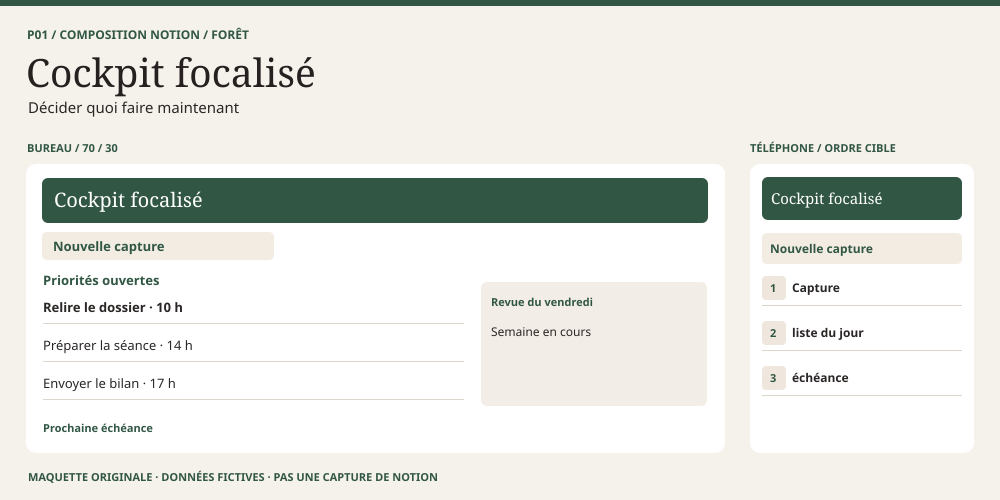
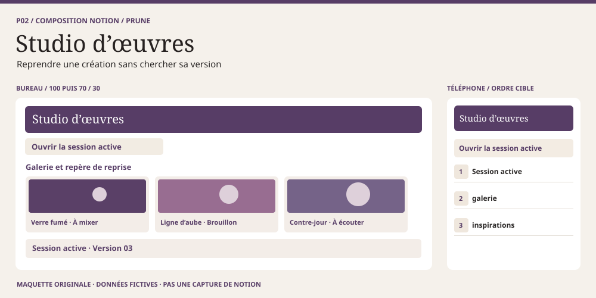
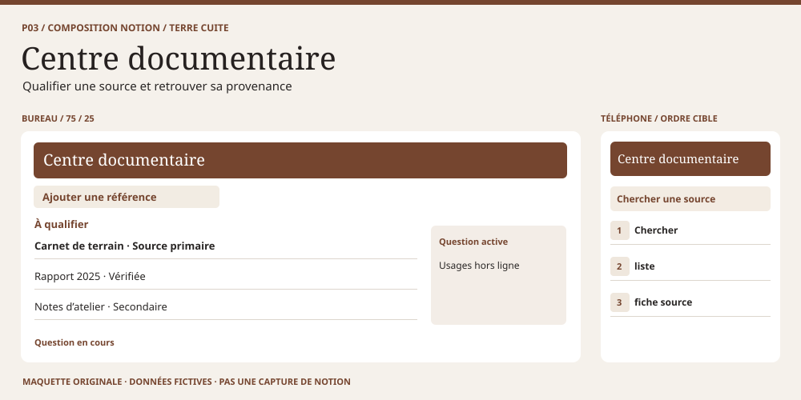
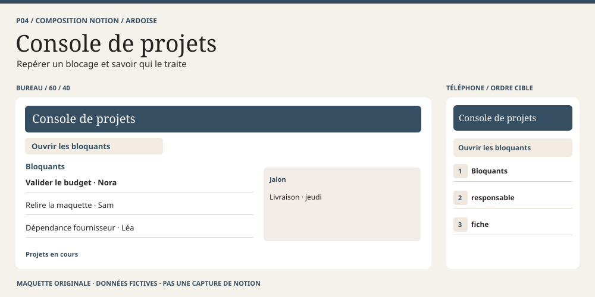
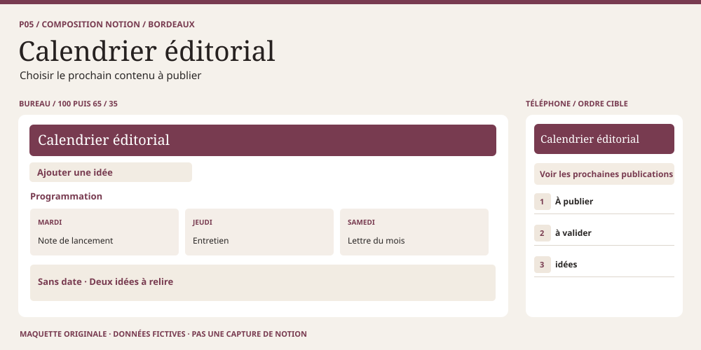
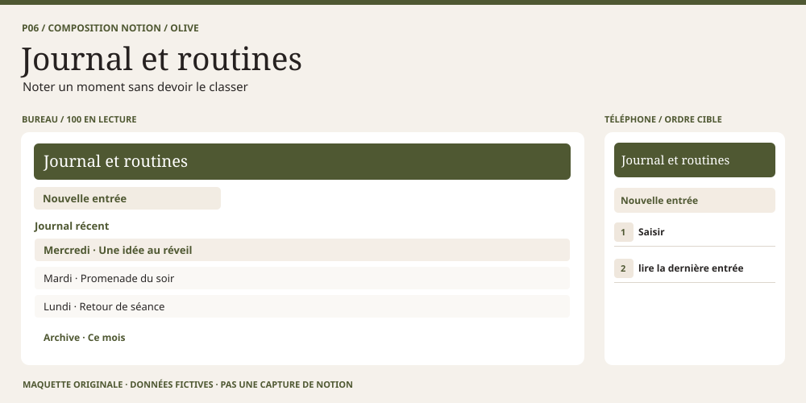
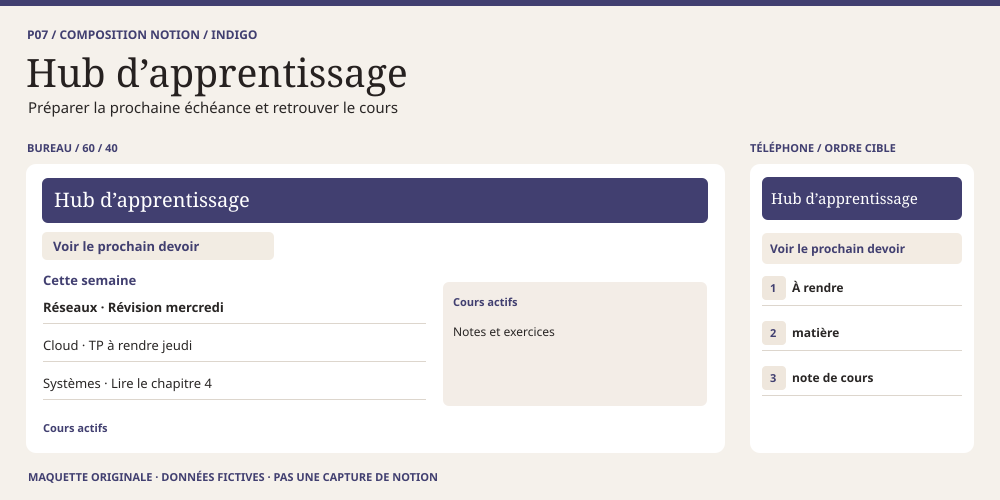
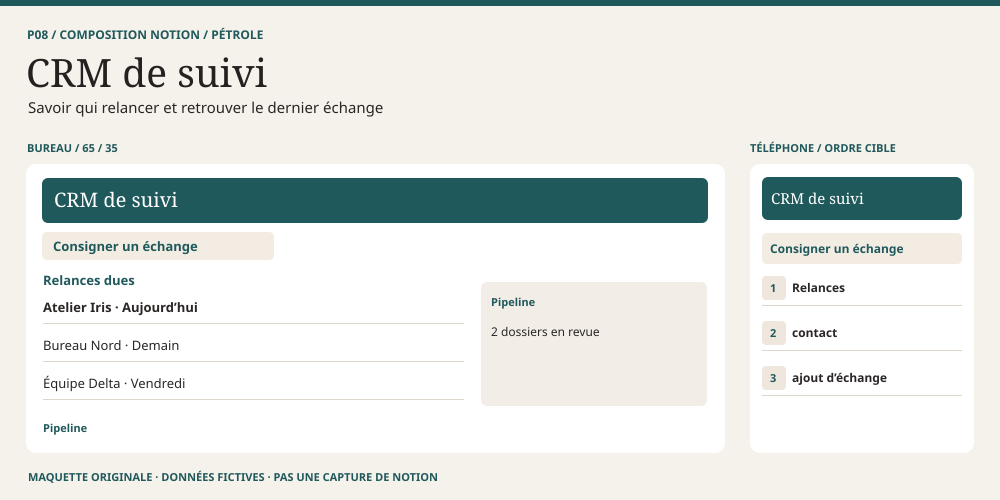
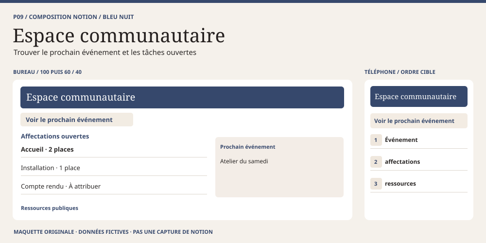
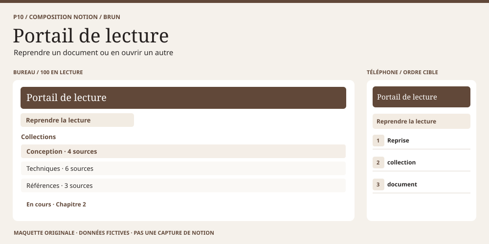

# Compositions — du croquis à l’écran

Chaque planche SVG est une **maquette originale réalisée**, avec données fictives. Le lien « Exemple Notion réel » ouvre une référence publique distincte : aperçu de modèle ou démonstration native, pas une capture de notre maquette ni une preuve de test. Aucun visuel tiers n’est repris. Les proportions décrivent des zones relatives de bureau, **pas des réglages au pixel**. Sur téléphone, l’ordre est une décision de conception à implémenter puis contrôler.

| Composition | Décision | Planche |
| --- | --- | --- |
| 01 · Cockpit focalisé | Décider quoi faire maintenant | [Voir](#p01-cockpit) |
| 02 · Studio d’œuvres | Reprendre une création sans chercher sa version | [Voir](#p02-studio) |
| 03 · Centre documentaire | Qualifier une source et retrouver sa provenance | [Voir](#p03-preuves) |
| 04 · Console de projets | Repérer un blocage et savoir qui le traite | [Voir](#p04-projets) |
| 05 · Calendrier éditorial | Choisir le prochain contenu à publier | [Voir](#p05-editorial) |
| 06 · Journal et routines | Noter un moment sans devoir le classer | [Voir](#p06-journal) |
| 07 · Hub d’apprentissage | Préparer la prochaine échéance et retrouver le cours | [Voir](#p07-etudes) |
| 08 · CRM de suivi | Savoir qui relancer et retrouver le dernier échange | [Voir](#p08-crm) |
| 09 · Espace communautaire | Trouver le prochain événement et les tâches ouvertes | [Voir](#p09-communaute) |
| 10 · Portail de lecture | Reprendre un document ou en ouvrir un autre | [Voir](#p10-lecture) |

## P01 cockpit

### Cockpit focalisé

- **Structure et proportions** — Action et file du jour, puis prochaine échéance. Point de départ bureau : **70 / 30**. La première zone répond à « décider quoi faire maintenant ? ». L’accent forêt est illustratif.
- **Blocs natifs et vues** — Bouton de page + liste liée « Aujourd’hui » + callout d’échéance.
- **État vide** — « Aucune action prévue aujourd’hui. Ouvrir les échéances. » Si seul un filtre est vide, conserver l’accès aux autres vues.
- **Téléphone** — Capture → liste du jour → échéance. Comparer cet ordre au parcours [mobile-first](../mobile-first/README.md), pas au seul empilement des colonnes.
- **Limite et vérification** — Ne pas masquer une tâche ouverte sans date. Prévoir une vue « Sans date ».
- **Exemple Notion réel à consulter** — [aperçu ou guide public](https://www.notion.com/templates/daily-dashboard). Observer la structure, pas reproduire ses actifs ni déduire son comportement mobile de l’aperçu.

## P02 studio

### Studio d’œuvres

- **Structure et proportions** — Galerie et repère de reprise, puis inspirations. Point de départ bureau : **100 puis 70 / 30**. La première zone répond à « reprendre une création sans chercher sa version ? ». L’accent prune est illustratif.
- **Blocs natifs et vues** — Galerie liée « Production » + mention d’œuvre active + liste Inspirations.
- **État vide** — « Aucune œuvre. Créer une première fiche ou relier une œuvre existante. » Si seul un filtre est vide, conserver l’accès aux autres vues.
- **Téléphone** — Session active → galerie → inspirations. Comparer cet ordre au parcours [mobile-first](../mobile-first/README.md), pas au seul empilement des colonnes.
- **Limite et vérification** — Une couverture identique partout réduit la reconnaissance. Tester une carte sans image.
- **Exemple Notion réel à consulter** — [aperçu ou guide public](https://www.notion.com/templates/music-and-audio-production-project-tracker). Observer la structure, pas reproduire ses actifs ni déduire son comportement mobile de l’aperçu.

## P03 preuves

### Centre documentaire

- **Structure et proportions** — Registre des sources, puis question en cours. Point de départ bureau : **75 / 25**. La première zone répond à « qualifier une source et retrouver sa provenance ? ». L’accent terre cuite est illustratif.
- **Blocs natifs et vues** — Liste liée + filtres par maturité et thème + propriétés de relation et URL.
- **État vide** — « Aucune source vérifiée pour ce thème. Voir « À qualifier ». » Si seul un filtre est vide, conserver l’accès aux autres vues.
- **Téléphone** — Chercher → liste → fiche source. Comparer cet ordre au parcours [mobile-first](../mobile-first/README.md), pas au seul empilement des colonnes.
- **Limite et vérification** — Un statut de vérification n’équivaut pas à une preuve de qualité. Conserver provenance et date.
- **Exemple Notion réel à consulter** — [aperçu ou guide public](https://www.notion.com/templates/reading-list). Observer la structure, pas reproduire ses actifs ni déduire son comportement mobile de l’aperçu.

## P04 projets

### Console de projets

- **Structure et proportions** — Bloquants et prochains jalons, puis projets en cours. Point de départ bureau : **60 / 40**. La première zone répond à « repérer un blocage et savoir qui le traite ? ». L’accent ardoise est illustratif.
- **Blocs natifs et vues** — Liste liée « Bloquants » + board « Phases » en secondaire + relation Actions/Projets.
- **État vide** — « Aucun blocage signalé. Consulter les prochaines échéances. » Si seul un filtre est vide, conserver l’accès aux autres vues.
- **Téléphone** — Bloquants → responsable → fiche. Comparer cet ordre au parcours [mobile-first](../mobile-first/README.md), pas au seul empilement des colonnes.
- **Limite et vérification** — Une fiche bloquée sans responsable doit rester visible. Un filtre n’isole pas des données privées.
- **Exemple Notion réel à consulter** — [aperçu ou guide public](https://www.notion.com/templates/notion-projects-and-tasks). Observer la structure, pas reproduire ses actifs ni déduire son comportement mobile de l’aperçu.

## P05 editorial

### Calendrier éditorial

- **Structure et proportions** — Calendrier et file de validation, puis idées sans date. Point de départ bureau : **100 puis 65 / 35**. La première zone répond à « choisir le prochain contenu à publier ? ». L’accent bordeaux est illustratif.
- **Blocs natifs et vues** — Calendrier lié sur date de publication + liste « Sans date » + filtre « À valider ».
- **État vide** — « Aucune publication prévue. Le backlog reste accessible. » Si seul un filtre est vide, conserver l’accès aux autres vues.
- **Téléphone** — À publier → à valider → idées. Comparer cet ordre au parcours [mobile-first](../mobile-first/README.md), pas au seul empilement des colonnes.
- **Limite et vérification** — Séparer date de brouillon et date de publication. Tester le passage de minuit si nécessaire.
- **Exemple Notion réel à consulter** — [aperçu ou guide public](https://www.notion.com/templates/content-calendar). Observer la structure, pas reproduire ses actifs ni déduire son comportement mobile de l’aperçu.

## P06 journal

### Journal et routines

- **Structure et proportions** — Capture et entrées datées, puis historique. Point de départ bureau : **100 en lecture**. La première zone répond à « noter un moment sans devoir le classer ? ». L’accent olive est illustratif.
- **Blocs natifs et vues** — Bouton de page + modèle court + liste par date, calendrier secondaire.
- **État vide** — « Aucune entrée pour aujourd’hui. Commencer par une phrase. » Si seul un filtre est vide, conserver l’accès aux autres vues.
- **Téléphone** — Saisir → lire la dernière entrée. Comparer cet ordre au parcours [mobile-first](../mobile-first/README.md), pas au seul empilement des colonnes.
- **Limite et vérification** — Distinguer entrée privée et suivi partagé. Ne pas imposer de score ni exposer un journal.
- **Exemple Notion réel à consulter** — [aperçu ou guide public](https://www.notion.com/templates/habit-tracker). Observer la structure, pas reproduire ses actifs ni déduire son comportement mobile de l’aperçu.

## P07 etudes

### Hub d’apprentissage

- **Structure et proportions** — À rendre et à réviser, puis cours actifs. Point de départ bureau : **60 / 40**. La première zone répond à « préparer la prochaine échéance et retrouver le cours ? ». L’accent indigo est illustratif.
- **Blocs natifs et vues** — Liste liée Tâches + liste Cours + relation Notes/Cours + mention d’archive.
- **État vide** — « Aucun travail à rendre dans cette période. Voir les cours actifs. » Si seul un filtre est vide, conserver l’accès aux autres vues.
- **Téléphone** — À rendre → matière → note de cours. Comparer cet ordre au parcours [mobile-first](../mobile-first/README.md), pas au seul empilement des colonnes.
- **Limite et vérification** — La date d’une séance ne doit pas remplacer la date limite. Tester un cours archivé.
- **Exemple Notion réel à consulter** — [aperçu ou guide public](https://www.notion.com/help/guides/get-organized-for-a-new-semester-with-notion). Observer la structure, pas reproduire ses actifs ni déduire son comportement mobile de l’aperçu.

## P08 crm

### CRM de suivi

- **Structure et proportions** — Relances et historique, puis pipeline. Point de départ bureau : **65 / 35**. La première zone répond à « savoir qui relancer et retrouver le dernier échange ? ». L’accent pétrole est illustratif.
- **Blocs natifs et vues** — Liste liée « Relances » + board par étape + relation avec le journal des échanges.
- **État vide** — « Aucune relance due. Vérifier les dossiers sans date. » Si seul un filtre est vide, conserver l’accès aux autres vues.
- **Téléphone** — Relances → contact → ajout d’échange. Comparer cet ordre au parcours [mobile-first](../mobile-first/README.md), pas au seul empilement des colonnes.
- **Limite et vérification** — Ne pas copier un contact pour chaque échange. Vérifier les droits avec un rôle lecteur.
- **Exemple Notion réel à consulter** — [aperçu ou guide public](https://www.notion.com/templates/sales-crm). Observer la structure, pas reproduire ses actifs ni déduire son comportement mobile de l’aperçu.

## P09 communaute

### Espace communautaire

- **Structure et proportions** — Événement en vedette et tâches, puis ressources publiques. Point de départ bureau : **100 puis 60 / 40**. La première zone répond à « trouver le prochain événement et les tâches ouvertes ? ». L’accent bleu nuit est illustratif.
- **Blocs natifs et vues** — Callout d’événement + liste liée Affectations + mentions vers les ressources.
- **État vide** — « Aucun événement annoncé. La procédure d’accueil reste visible. » Si seul un filtre est vide, conserver l’accès aux autres vues.
- **Téléphone** — Événement → affectations → ressources. Comparer cet ordre au parcours [mobile-first](../mobile-first/README.md), pas au seul empilement des colonnes.
- **Limite et vérification** — La page publique ne doit pas exposer les coordonnées ou les notes des bénévoles.
- **Exemple Notion réel à consulter** — [aperçu ou guide public](https://www.notion.com/templates/event-planning). Observer la structure, pas reproduire ses actifs ni déduire son comportement mobile de l’aperçu.

## P10 lecture

### Portail de lecture

- **Structure et proportions** — Reprise et collection, puis bibliothèque. Point de départ bureau : **100 en lecture**. La première zone répond à « reprendre un document ou en ouvrir un autre ? ». L’accent brun est illustratif.
- **Blocs natifs et vues** — Mention du document actif + liste par thème + modèle de fiche source.
- **État vide** — « Aucun document commencé. Choisir une source dans la collection. » Si seul un filtre est vide, conserver l’accès aux autres vues.
- **Téléphone** — Reprise → collection → document. Comparer cet ordre au parcours [mobile-first](../mobile-first/README.md), pas au seul empilement des colonnes.
- **Limite et vérification** — Préserver lien et attribution. Une version résumée ne remplace pas l’original.
- **Exemple Notion réel à consulter** — [aperçu ou guide public](https://www.notion.com/templates/reading-list). Observer la structure, pas reproduire ses actifs ni déduire son comportement mobile de l’aperçu.
