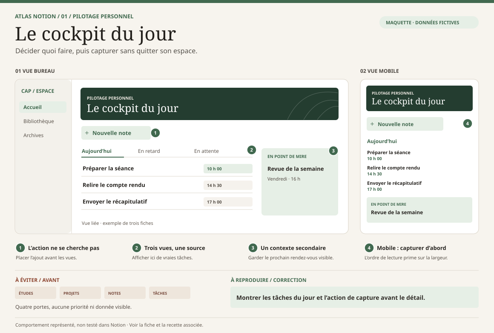
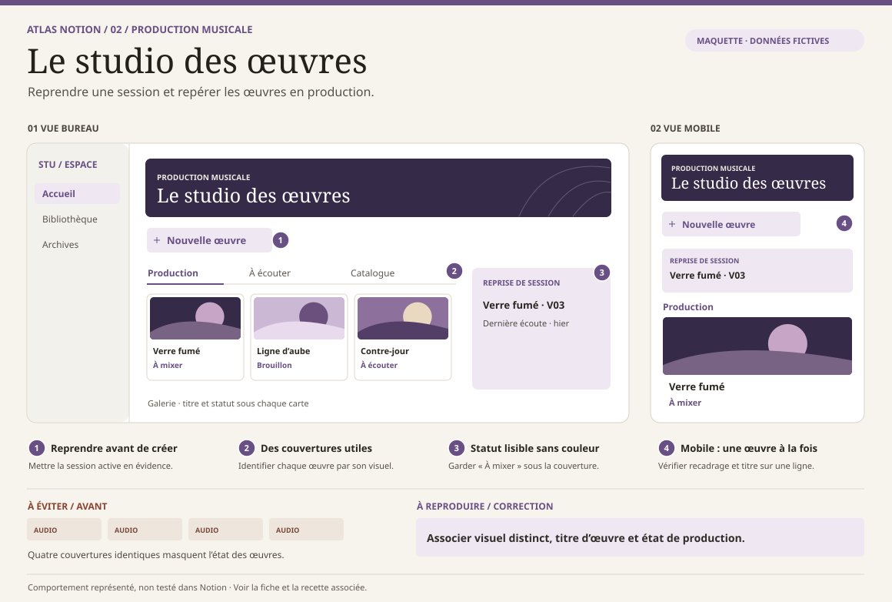
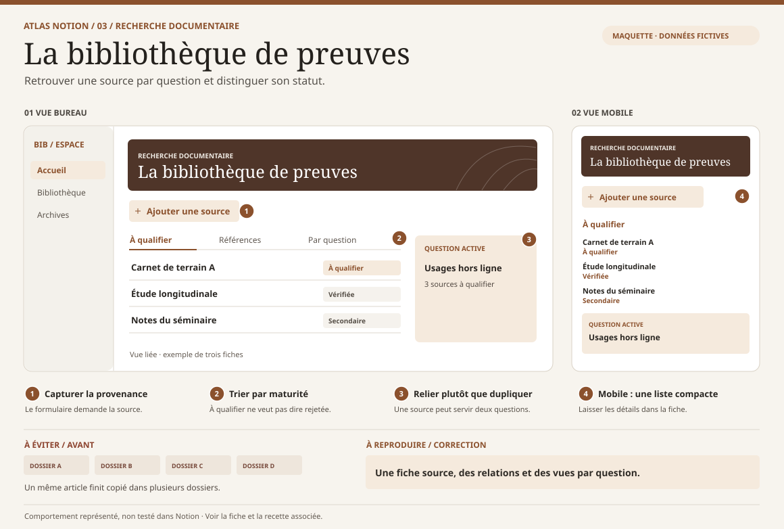

# Étape 06 — Atlas visuel annoté

**Statut : trois maquettes originales réalisées en SVG**, pas des captures de Notion. Toutes les données sont fictives. Les planches illustrent le rendu attendu sur bureau et l’ordre à rechercher sur téléphone. Elles ne prouvent ni le rendu natif ni le fonctionnement des actions.

| Planche | Décision à prendre | Composition | Recettes |
| --- | --- | --- | --- |
| [01 — Cockpit](#01--le-cockpit-du-jour) | Que faire maintenant ? | Action rapide + liste temporelle | [R01](../implementation-recipes/actions.md#r01--capturer-une-note-dans-la-source-existante), [R04](../implementation-recipes/views-and-layout.md#r04--retrouver-le-travail-dans-des-vues-liées) |
| [02 — Studio](#02--le-studio-des-œuvres) | Quelle œuvre reprendre ? | Galerie à couvertures et repère de session | [R05](../implementation-recipes/views-and-layout.md#r05--montrer-des-œuvres-en-galerie), [R07](../implementation-recipes/views-and-layout.md#r07--construire-une-page-lisible-sur-téléphone) |
| [03 — Recherche](#03--la-bibliothèque-de-preuves) | Quelle preuve manque ou mérite vérification ? | Registre des sources et regroupement par question | [R03](../implementation-recipes/actions.md#r03--recueillir-une-entrée-structurée-avec-un-formulaire), [R08](../implementation-recipes/data-and-qa.md#r08--relier-les-fiches-sans-dupliquer-les-données) |

## 01 — Le cockpit du jour

- **À regarder en premier** — l’action + Nouvelle note, puis la liste qui permet de choisir la prochaine tâche. Trois onglets ne signifient pas trois bases. Le repère secondaire ne doit pas devenir un second tableau de bord.
- **Interaction attendue** — l’ajout crée une seule fiche dans Inbox. Elle s’ouvre pour compléter le contenu et le classement. La vue de bibliothèque remonte cette même fiche si elle satisfait le filtre.
- **À adapter** — en support IT, remplacer les échéances personnelles par la prochaine intervention et une liste par urgence. Si la capture est rare, placer l’action après la file. État vide : « Rien d’échu aujourd’hui », avec un lien vers les prochaines échéances.
- **Anti-pattern** — quatre raccourcis du même poids donnent des destinations, pas un état du travail. Correction : montrer la donnée qui permet de décider sans ouvrir une autre page.

## 02 — Le studio des œuvres

- **À regarder en premier** — le repère « Reprise de session » désigne le travail à reprendre. Sur téléphone, il doit précéder la galerie. « Nouvelle œuvre » reste une action distincte et ne sert pas à créer une version de l’œuvre active.
- **Interaction attendue** — ouvrir la carte pour retrouver la fiche, sa version courante et le lien d’écoute. Tant qu’un repère automatique n’a pas été configuré et vérifié, le maintenir manuellement ou afficher une vue « En cours ».
- **À adapter** — en photographie, montrer les séries et le statut de livraison. En écriture, supprimer les couvertures si elles n’aident pas à distinguer les textes et utiliser une liste par état. Si l’œuvre n’a pas de couverture, garder titre et état utiles.
- **Anti-pattern** — recycler la même image sur quatre cartes cache l’information. Correction : un visuel propre à l’œuvre et un état écrit, y compris en mode sombre.

## 03 — La bibliothèque de preuves

- **À regarder en premier** — l’état « À qualifier », puis la question que cette preuve renseigne. Le texte indique la maturité indépendamment de l’accent ocre. Le registre est plus compact qu’une galerie et ne nécessite pas de couvertures.
- **Interaction attendue** — déposer une référence, vérifier sa provenance, puis la relier à une ou plusieurs questions sans recopier le texte. Ouvrir la fiche pour consulter la provenance et les notes.
- **À adapter** — en recrutement, relier une seule fiche candidat à ses échanges selon les permissions. En classe, distinguer les ressources à vérifier de celles validées. Si aucune preuve n’est disponible, écrire « Aucune source vérifiée pour cette question » et laisser la capture accessible.
- **Anti-pattern** — dupliquer une référence dans chaque dossier fragmente les corrections et l’historique. Correction : une fiche, plusieurs relations, des vues filtrées.

## Utiliser ou enrichir l’atlas

1. Partir d’une décision observée dans le [brief](../research-playbook/README.md), pas d’une palette. Choisir ce qui mérite d’être reproduit et expliquer ce qui doit changer.
2. Prototyper le parcours principal avec une [recette](../implementation-recipes/README.md). Les couvertures stylisées, la navigation, les dimensions, l’ordre et les boutons du SVG sont illustratifs. L’icône dessinée indique le rôle attendu, pas une garantie de rendu dans Notion.
3. Pour toute nouvelle planche, fournir le besoin, l’origine des visuels, un bureau + un mobile, 3–5 repères, un contre-exemple et sa correction, un état vide, et au moins une recette. Le contre-exemple doit faire voir une erreur de parcours, pas seulement un mauvais choix de couleur.
4. Étiqueter `MAQUETTE` (visuel original), `CAPTURE NATIVE` (rendu observé) ou `CAPTURE NATIVE + TEST` (rendu et action contrôlés, avec journal). Pour une capture publique : espace de test, données fictives, aucun identifiant personnel ni template tiers sans droit. Une capture native seule ne prouve pas un clic.

Les trois SVG sont autonomes et ne chargent ni police distante, ni image tierce. Source éditable dans [assets](assets/).

Pour les autres compositions, consulter les [dix planches de la bibliothèque](../composition-library/visual-cards.md), qui associent également une référence Notion publique à chaque maquette originale.
